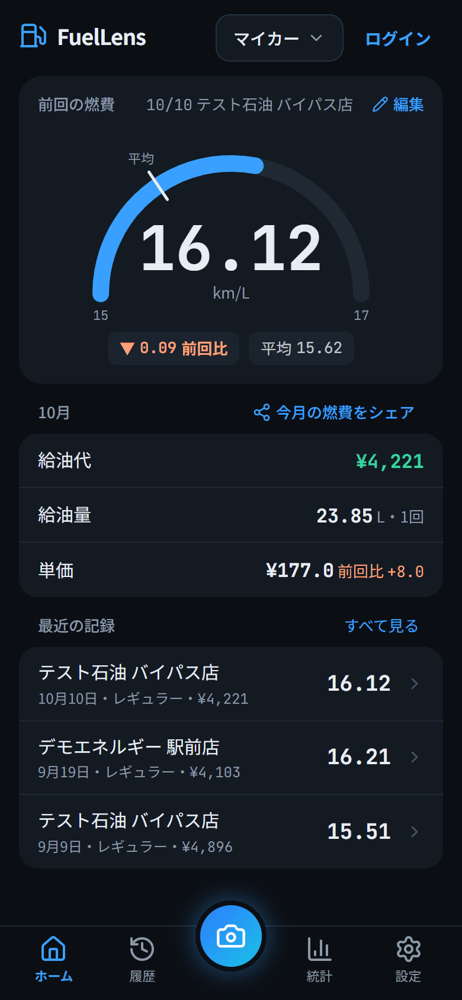
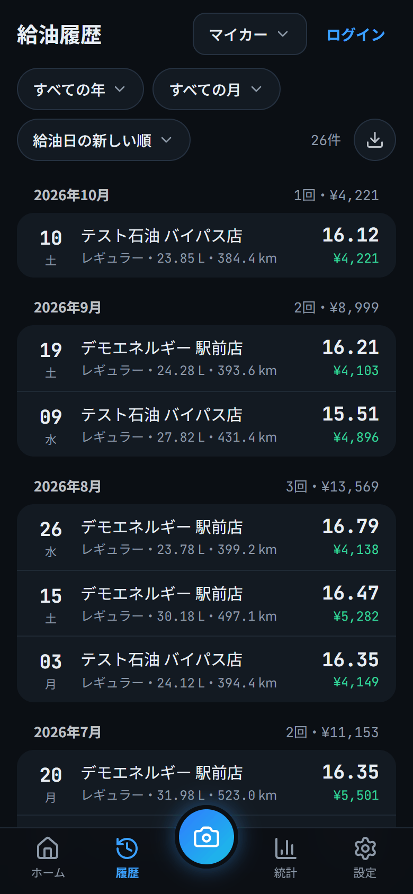
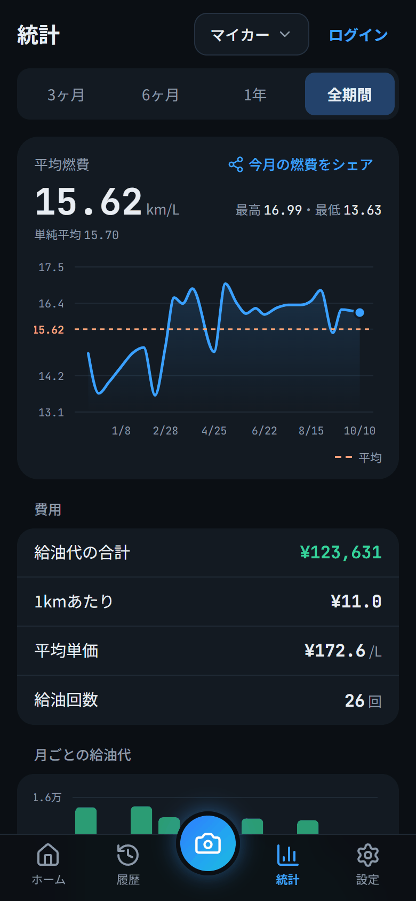
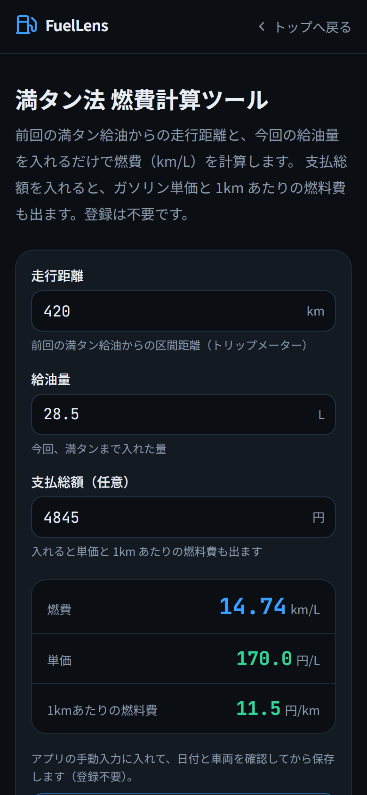
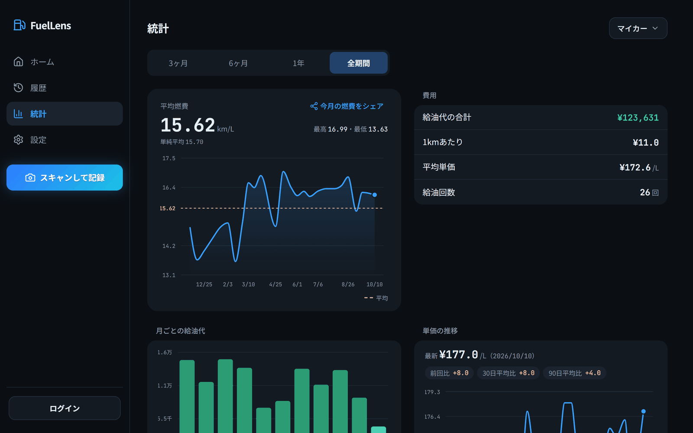
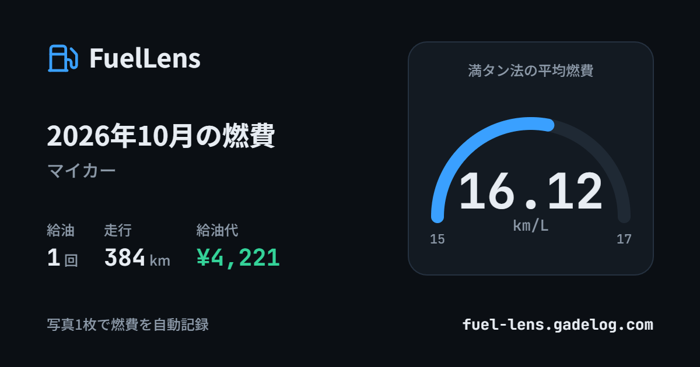

# FuelLens

**レシートとトリップメーターを 1 枚に撮るだけで、燃費を記録できる Web アプリ。**

ガソリンスタンドのレシートと車のトリップメーターが写った写真を撮影（またはアップロード）すると、
AI（Google Gemini）が給油量・金額・走行距離を読み取り、満タン法で燃費を計算して記録します。

- **アプリ**: https://fuel-lens.gadelog.com （無料。手入力ならログインなしで使えます。AI の読み取りはログイン後）
- **ログイン不要の計算ツール**: [満タン法 燃費計算](https://fuel-lens.gadelog.com/calc)・[ガソリン代計算](https://fuel-lens.gadelog.com/gas-cost)・[ガソリン代の割り勘](https://fuel-lens.gadelog.com/warikan)・[主要区間のガソリン代](https://fuel-lens.gadelog.com/route-gas-cost)・[年間ガソリン代](https://fuel-lens.gadelog.com/annual-gas-cost)・[燃費の単位換算](https://fuel-lens.gadelog.com/fuel-convert)

<table>
  <tr>
    <td align="center"></td>
    <td align="center"></td>
    <td align="center"></td>
    <td align="center"></td>
  </tr>
  <tr>
    <td align="center">ホーム</td>
    <td align="center">給油履歴</td>
    <td align="center">統計</td>
    <td align="center">燃費計算ツール</td>
  </tr>
</table>

  

スクリーンショットは架空のデモデータです。

## 何ができるか

- **写真 1 枚で記録（AI 読み取り）**: レシートの給油量・金額・スタンド名と、トリップメーターの区間距離を読み取ります。
  保存前に確認シートで内容を確認・修正でき、自信のない項目は「要確認」として強調されます。**AI の読み取りはログインが必要です**（`TRIAL_COOKIE_SECRET` を設定したデプロイでは、ログインなしでも端末ごとに 3 回まで試せます。[docs/api-analyze.md](./docs/api-analyze.md#未ログインのお試し読み取り)）。
- **ログインなしでも使える**: 手動入力・履歴・統計はログインなしで使え、記録はブラウザ（localStorage）に保存されます。
  ログインすると記録はクラウドに保存され、複数の端末で共有できます（ログイン前の記録は自動で引き継ぎます）。
- **燃費と単価を自動計算**: 満タン法で燃費（km/L）を、支払総額と給油量から単価（円/L）を計算します。
- **履歴と統計**: 月ごとの履歴、期間別の平均燃費・費用、燃費や給油代・単価の推移グラフを表示します。
- **複数の車両**: 車やバイクを複数登録し、車両ごとに記録を分けて管理できます。
- **部分給油とオドメーター入力**: 満タンにしなかった給油は「部分給油」として記録し、次の満タン給油でまとめて燃費を出します。
  車両ごとに、トリップメーターの区間距離を入れる方式と、オドメーター（積算距離）の差分から出す方式を選べます。
- **燃料種別とメモ**: 給油ごとにレギュラー / ハイオク / 軽油などの燃料種別と、短いメモを残せます。
- **燃費のシェア画像**: 今月の燃費をまとめたカード画像を作り、共有や保存ができます（画像は端末の中で作ります）。
- **バックアップと CSV**: 全車両・全記録を JSON でバックアップし、復元できます（復元は追記のみで、既存のデータは消しません）。
  記録は CSV でも書き出せます。
- **ホーム画面に追加（PWA）**: スマホのホーム画面から起動できます。Android では写真アプリの「共有」から直接読み取れます。
  オフラインでの動作には対応していません。

  

## 燃費の計算について（満タン法）

- 燃費（km/L） = **前回の満タン給油からの走行距離 ÷ 給油量の合計**
- トリップメーターの車両（既定）で入力する「走行距離」は、**前回給油時にリセットしたトリップメーターの値（区間距離）** です。
  オドメーター（積算距離）の値を走行距離に入力しないでください。
- オドメーターの車両は、給油時のオドメーターを入力します。**前回の記録との差分**が区間距離になります
  （最初の記録や、前回の記録にオドメーターが無い場合は区間距離を出せません）。
- 部分給油（満タンにしなかった給油）は、その場では燃費を出さず、**次の満タン給油にまとめて**計算します
  （間の走行距離と給油量を合計して、合計距離 ÷ 合計給油量）。
- 記録し忘れた給油がある場合は「前回の給油を記録し忘れた」を付けると、そこで計算を区切ります。
- 正確な燃費を出すには、**満タン給油を基準**にしてください。トリップメーターの車両は給油のたびにリセットします。
  計算の詳細は [docs/design-fill-chain.md](./docs/design-fill-chain.md) を参照してください。

## 使っている技術

- **フロントエンド**: Next.js 16（App Router）/ React 19 / TypeScript / Tailwind CSS v4 / Recharts
- **AI**: Google Gemini（`@google/genai`。サーバー側だけで呼び出します）
- **認証・データベース**: Clerk / Supabase（PostgreSQL + 行レベルセキュリティ）
- **ホスティング**: Vercel（ページビューは Cookie を使わない Vercel Web Analytics で計測）

選定理由は [docs/tech_stack.md](./docs/tech_stack.md) にまとめています。

## 開発者向け

ローカルでの起動手順・環境変数・開発コマンドは [docs/setup.md](./docs/setup.md) を参照してください。
設計・API・運用のドキュメントは [docs/README.md](./docs/README.md) から辿れます。

## ライセンス

[MIT License](./LICENSE)
